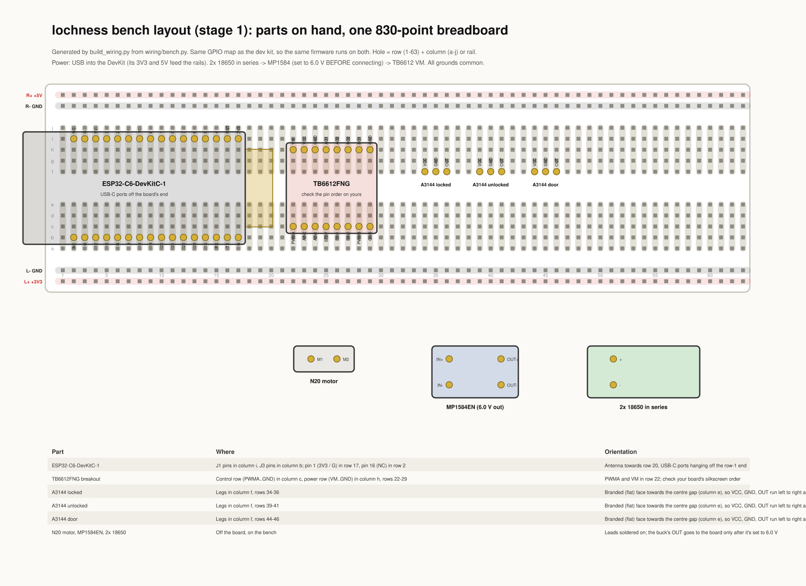
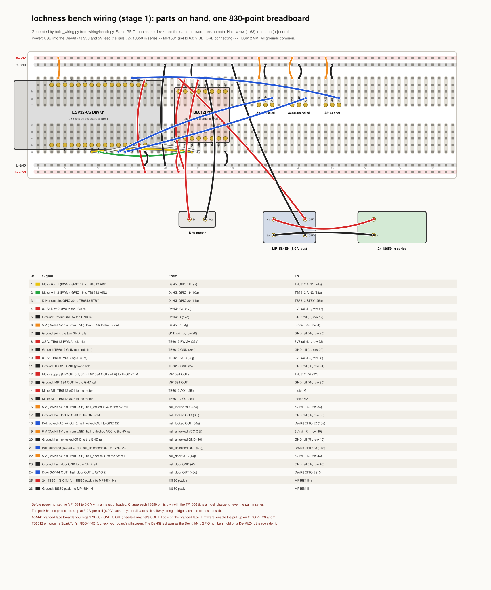
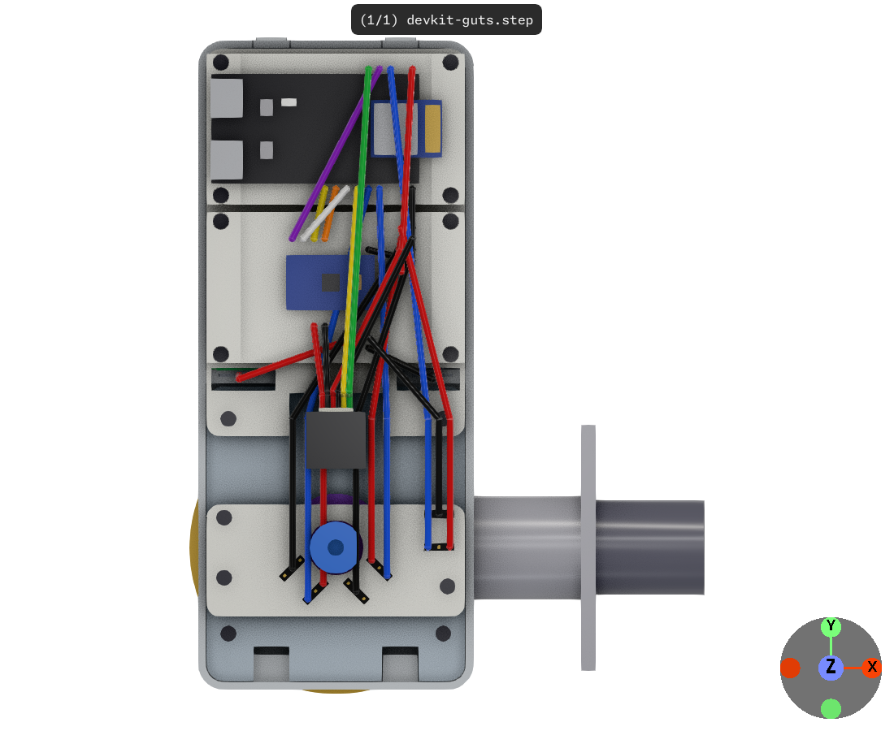
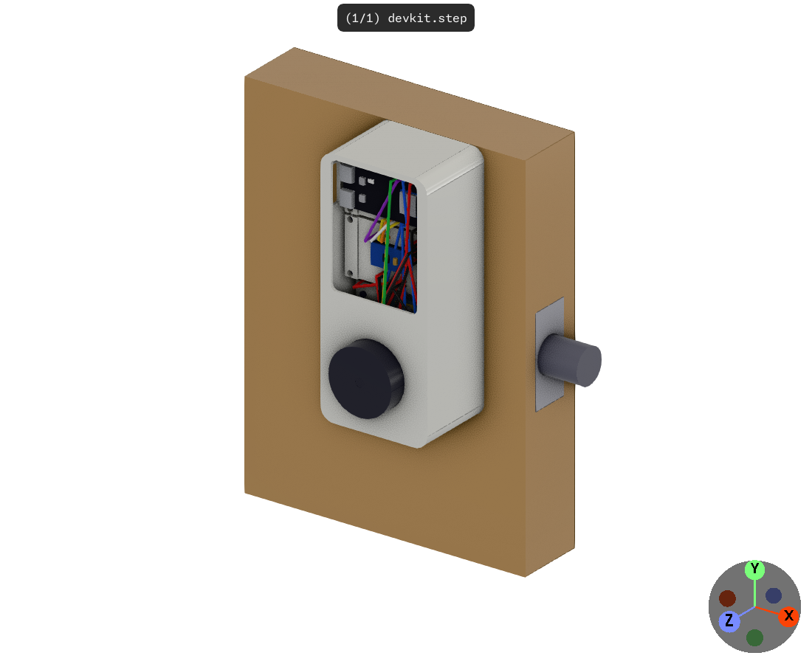
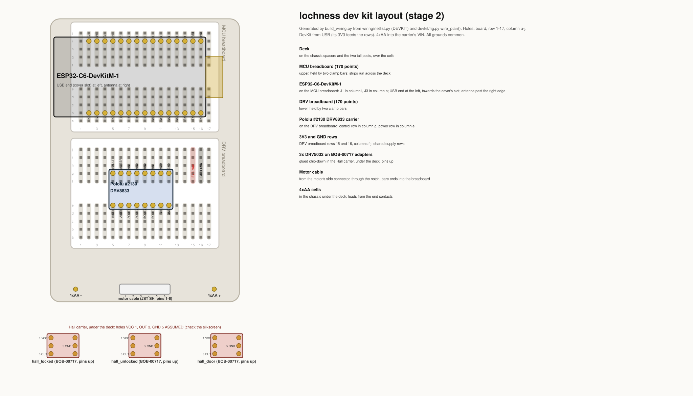
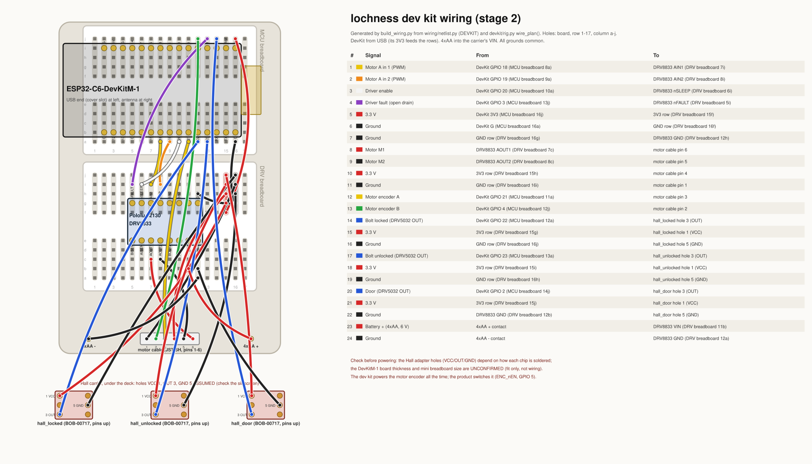

# lochness bench and dev kit setup

<!-- Generated by build_wiring.py (wiring/guide.py). Edit those, not this file. -->

Two ways to build the lock's electronics before the main PCB exists:

|  | Stage 1: bench | Stage 2: dev kit |
|---|---|---|
| What | One 830-point breadboard on the bench | Printed lock body on a real door, two mini breadboards |
| Board | ESP32-C6-DevKitC-1 | ESP32-C6-DevKitM-1 |
| Motor driver | TB6612FNG breakout | Pololu #2130 (DRV8833) |
| Motor | N20, 6 V, no encoder | Pololu #5193, 150:1, 12 CPR encoder |
| Bolt and door switches | 3x A3144 | 3x DRV5032FA on SOT-23 adapters |
| Motor supply | 2x 18650, MP1584EN at 6.0 V | 4x AA lithium |
| Wires | 26 | 24 |

Both run the same firmware: the GPIO map is the same, and the bench leaves out only what its parts don't have.

- [Pin map](#pin-map)
- [Stage 1: the bench](#stage-1-the-bench)
- [Stage 2: the printed dev kit](#stage-2-the-printed-dev-kit)
- [Firmware](#firmware)
- [Checks behind this guide](#checks-behind-this-guide)

> **Safety:** the 18650 pack has no protection circuit. Charge each cell alone on the TP4056, set the MP1584 to 6.0 V before connecting it, and stop at 3.0 V per cell. Connect motor power last, and only after checking the logic side on USB alone.

## Pin map

Both builds use the same GPIOs, so the same firmware runs on both. The map is `PIN_MAP` in `wiring/netlist.py`; the product's main PCB uses it too.

| GPIO | Net | Dev kit | Bench |
|---|---|---|---|
| 2 | HALL_DOOR | Door (DRV5032 OUT) | Door (A3144) |
| 3 | DRV_nFAULT | Driver fault (open drain) | unused (TB6612FNG has no fault output) |
| 4 | ENC_B | Motor encoder B | unused (N20 has no encoder) |
| 18 | MOT_IN1 | Motor A in 1 (PWM) | Motor A in 1 |
| 19 | MOT_IN2 | Motor A in 2 (PWM) | Motor A in 2 |
| 20 | DRV_nSLEEP | Driver enable | Driver enable |
| 21 | ENC_A | Motor encoder A | unused (N20 has no encoder) |
| 22 | HALL_LOCKED | Bolt locked (DRV5032 OUT) | Bolt locked (A3144) |
| 23 | HALL_UNLOCKED | Bolt unlocked (DRV5032 OUT) | Bolt unlocked (A3144) |

Avoided on purpose: GPIO 8, 9 and 15 (strapping pins; 8 also drives the DevKit's RGB LED), 12 and 13 (USB), 16 and 17 (UART0).

## Stage 1: the bench

The lock's circuit on one breadboard, from the parts on hand. It differs from the dev kit in four ways, and none of them changes the GPIO map:

- **Motor driver:** a TB6612FNG instead of the DRV8833. Its STBY pin is on GPIO 20, where the DRV8833's nSLEEP was. PWMA is tied to 3.3 V, so PWM on AIN1/AIN2 drives it the same way. It has no fault output, so GPIO 3 is unused.
- **Motor:** the N20 has no encoder, so GPIO 21 and 4 are unused.
- **Hall switches:** A3144s instead of DRV5032s. They need 4.5 V or more, so they run from the DevKit's 5 V. Their outputs are open collector, so the firmware turns on the GPIO pull-ups.
- **Motor supply:** 2x 18650 through an MP1584EN set to 6.0 V, instead of 4xAA.

### Parts

| Qty | Part | On hand | Before you start |
|---|---|---|---|
| 1 | Espressif ESP32-C6-DevKitC-1 | yes | Headers fitted. The bench drawing is for this board. |
| 1 | TB6612FNG dual motor driver breakout | yes | Solder its two 1x8 headers, pins down. |
| 1 | N20 gearmotor, 6 V, no encoder | yes | Solder a red and a black lead to its tabs. |
| 3 | A3144 Hall switch (TO-92) | yes | Locked, unlocked and door. Needs 4.5 V or more. |
| 1 | MP1584EN buck module | yes | Solder leads or pins to IN+, IN-, OUT+ and OUT-. Set to 6.0 V before use. |
| 2 | 18650 Li-ion cell | yes | Charged one at a time on the TP4056. |
| 1 | TP4056 1-cell charger module | yes | For charging only. It is not in the circuit. |
| 1 | 830-point breadboard with power rails | yes (ELEGOO kit) |  |
| 26 | Jumper wires | yes (ELEGOO kit) |  |
| 1 | 2-cell 18650 holder, in series, with leads | **no** | Not in your inventory. Any 2S holder. |
| 1 | Small neodymium magnet | **check** | To trigger the A3144s (south pole to the branded face). |
| 1 | USB-C data cable | **check** | Powers and programs the DevKit. |

Jumper wires by colour: 10 black, 6 red, 4 orange, 3 blue, 1 yellow, 1 green, 1 white.

Tools: Multimeter (to set the MP1584 and check the rails), soldering iron.

Not used: Seeed XIAO ESP32C6, PN532 NFC, and the ELEGOO kit's power module.

### Layout

Where each part sits. Holes are row (1-63) and column (a-j), or a rail: L+ and L- run along column a's side, R+ and R- along column j's.

| Part | Where | Orientation |
|---|---|---|
| ESP32-C6-DevKitC-1 | J1 pins in column i, J3 pins in column b; pin 1 (3V3 / G) in row 17, pin 16 (NC) in row 2 | Antenna towards row 20, USB-C ports hanging off the row-1 end |
| TB6612FNG breakout | Control row (PWMA..GND) in column c, power row (VM..GND) in column h, rows 22-29 | PWMA and VM in row 22; check your board's silkscreen order |
| A3144 locked | Legs in column f, rows 34-36 | Branded (flat) face towards the centre gap (column e), so VCC, GND, OUT run left to right as you face it |
| A3144 unlocked | Legs in column f, rows 39-41 | Branded (flat) face towards the centre gap (column e), so VCC, GND, OUT run left to right as you face it |
| A3144 door | Legs in column f, rows 44-46 | Branded (flat) face towards the centre gap (column e), so VCC, GND, OUT run left to right as you face it |
| N20 motor, MP1584EN, 2x 18650 | Off the board, on the bench | Leads soldered on; the buck's OUT goes to the board only after it's set to 6.0 V |

Rails: L+ is 3.3 V, R+ is 5 V, and both minus rails are ground. On some 830-point boards each rail is split halfway along. If yours are, bridge each one across the split.

### Wiring

| # | Colour | Signal | From | To |
|---|---|---|---|---|
| 1 | yellow | Motor A in 1 (PWM): GPIO 18 to TB6612 AIN1 | DevKit GPIO 18 (8a) | TB6612 AIN1 (24a) |
| 2 | green | Motor A in 2 (PWM): GPIO 19 to TB6612 AIN2 | DevKit GPIO 19 (9a) | TB6612 AIN2 (23a) |
| 3 | white | Driver enable: GPIO 20 to TB6612 STBY | DevKit GPIO 20 (10a) | TB6612 STBY (25a) |
| 4 | red | 3.3 V: DevKit 3V3 to the 3V3 rail | DevKit 3V3 (17j) | 3V3 rail (L+, row 17) |
| 5 | black | Ground: DevKit GND to the GND rail | DevKit G (17a) | GND rail (L-, row 17) |
| 6 | orange | 5 V (DevKit 5V pin, from USB): DevKit 5V to the 5V rail | DevKit 5V (4j) | 5V rail (R+, row 4) |
| 7 | black | Ground: joins the two GND rails | GND rail (L-, row 20) | GND rail (R-, row 20) |
| 8 | red | 3.3 V: TB6612 PWMA held high | TB6612 PWMA (22a) | 3V3 rail (L+, row 22) |
| 9 | black | Ground: TB6612 GND (control side) | TB6612 GND (29a) | GND rail (L-, row 29) |
| 10 | red | 3.3 V: TB6612 VCC (logic 3.3 V) | TB6612 VCC (23j) | 3V3 rail (L+, row 23) |
| 11 | black | Ground: TB6612 GND (power side) | TB6612 GND (24j) | GND rail (R-, row 24) |
| 12 | red | Motor supply (MP1584 out, 6 V): MP1584 OUT+ (6 V) to TB6612 VM | MP1584 OUT+ | TB6612 VM (22j) |
| 13 | black | Ground: MP1584 OUT- to the GND rail | MP1584 OUT- | GND rail (R-, row 30) |
| 14 | red | Motor M1: TB6612 AO1 to the motor | TB6612 AO1 (25j) | motor M1 |
| 15 | black | Motor M2: TB6612 AO2 to the motor | TB6612 AO2 (26j) | motor M2 |
| 16 | orange | 5 V (DevKit 5V pin, from USB): hall_locked VCC to the 5V rail | hall_locked VCC (34j) | 5V rail (R+, row 34) |
| 17 | black | Ground: hall_locked GND to the GND rail | hall_locked GND (35j) | GND rail (R-, row 35) |
| 18 | blue | Bolt locked (A3144 OUT): hall_locked OUT to GPIO 22 | hall_locked OUT (36g) | DevKit GPIO 22 (12a) |
| 19 | orange | 5 V (DevKit 5V pin, from USB): hall_unlocked VCC to the 5V rail | hall_unlocked VCC (39j) | 5V rail (R+, row 39) |
| 20 | black | Ground: hall_unlocked GND to the GND rail | hall_unlocked GND (40j) | GND rail (R-, row 40) |
| 21 | blue | Bolt unlocked (A3144 OUT): hall_unlocked OUT to GPIO 23 | hall_unlocked OUT (41g) | DevKit GPIO 23 (13a) |
| 22 | orange | 5 V (DevKit 5V pin, from USB): hall_door VCC to the 5V rail | hall_door VCC (44j) | 5V rail (R+, row 44) |
| 23 | black | Ground: hall_door GND to the GND rail | hall_door GND (45j) | GND rail (R-, row 45) |
| 24 | blue | Door (A3144 OUT): hall_door OUT to GPIO 2 | hall_door OUT (46g) | DevKit GPIO 2 (6j) |
| 25 | red | 2x 18650 + (6.0-8.4 V): 18650 pack + to MP1584 IN+ | 18650 pack + | MP1584 IN+ |
| 26 | black | Ground: 18650 pack - to MP1584 IN- | 18650 pack - | MP1584 IN- |

### Setup

Do these in order. The motor supply goes on last, after the logic side has been checked on USB alone.

1. **Charge the cells, one at a time.** Use the TP4056 on each 18650 alone. It is a 1-cell charger, so never charge the pair in series. Each cell should read 4.1-4.2 V when charged.
2. **Make the pack.** Put both cells in the 2S holder and check the leads read 6.0-8.4 V.
3. **Set the MP1584 to 6.0 V.** Connect the pack to IN+ and IN- (wires 25 and 26), with nothing on OUT. Turn its trimmer until a meter on OUT+/OUT- reads 6.0 V. Then disconnect the pack.
4. **Place the parts** as in the layout, with no power connected.
5. **Wire the rails:** wires 4, 5, 6, 7, 8, 9, 10 and 11.
6. **Wire the motor control signals:** wires 1, 2 and 3.
7. **Wire the Hall switches:** wires 16, 17, 18, 19, 20, 21, 22, 23 and 24.
8. **Check on USB alone.** Plug in the DevKit's USB, with the pack still disconnected. Measure 3.2-3.4 V on the L+ rail and 4.7-5.25 V on the R+ rail, both against ground. Nothing should get warm.
9. **Flash and test the switches.** The firmware must enable the internal pull-ups on GPIO 2, 22 and 23; without them, the A3144 inputs float. Each switch reads 1 with no magnet and 0 with a magnet's south pole against its branded face. See [Firmware](#firmware) below.
10. **Connect the motor supply.** Unplug USB. Connect the pack to the MP1584 again, then its OUT to the board and the motor leads (wires 12, 13, 14 and 15). Plug USB back in.
11. **Test the motor.** With STBY (GPIO 20) high: AIN1 (GPIO 18) high and AIN2 (GPIO 19) low turns it one way, and the reverse turns it the other. Both low lets it coast; both high brakes it. PWM on the high pin sets the speed.
12. **When you're done,** disconnect the pack. It has no protection circuit: stop using it when either cell reaches 3.0 V (6.0 V for the pack), and recharge.

## Stage 2: the printed dev kit

The tall slab (concept B), opened up, on a real door. It has the product's drive, motor, battery bay and chips, each on a breakout. Two mini breadboards on a printed deck replace the main PCB. The 3D model is in `devkit/rig.py`; `uv run view.py devkit` shows it on the door.

### Parts

The electronics and wiring. The full list (printed parts, 4 metal and 11 fastener lines, prices and suppliers) is in [bom/devkit.csv](bom/devkit.csv): $125.51 in all.

| Qty | Part | Supplier | Notes |
|---|---|---|---|
| 1 | Espressif ESP32-C6-DevKitM-1 (the product's ESP32-C6-MINI-1 module), on its pin headers | DigiKey 1965-ESP32-C6-DEVKITM-1-N4-ND | Headers appear fitted in photos; the user guide doesn't say. |
| 2 | Mini breadboard, 170 points (47 x 35 mm), adhesive back | SparkFun PRT-12043 |  |
| 1 | NdFeB magnet 3 x 2 mm, axial (bolt position) | Apex Magnets M3x2MMDI | N48. Pack of 50 for $8.99. |
| 1 | Pololu #2130 DRV8833 dual motor driver carrier, on 2x 1x8 pin headers | Pololu 2130 | Headers included, unsoldered. |
| 1 | Pololu #5193 gearmotor, 150:1 HPCB 6 V, 12 CPR encoder, side connector (6-pin JST SH cable) | Pololu 5193 | Cable not included. $29.85 each at 5+. |
| 3 | SparkFun BOB-00717 SOT-23 adapter with a DRV5032FADBZR and 2x 1x3 header, worn chip-down | SparkFun BOB-00717 | Adapter only: the chip and headers are separate lines. Page says 8.6 x 11.7 mm. |
| 3 | DRV5032FADBZR Hall switch, SOT-23 (soldered to the adapters) | DigiKey 296-47765-1-ND |  |
| 1 | Break-away male headers, 40-pin, 0.1" (2x 1x3 per adapter) | SparkFun PRT-00116 |  |
| 1 | Motor cable, 6-pin JST SH-style to bare wires, 12 cm (tinned ends into the breadboard) | Pololu 4762 | Or a #4765 cable and a #4772 breakout ($1.49) for 0.1" pins. |
| 1 | Door-frame magnet for the door-position switch, NdFeB disc about 10 x 3 mm, axial, adhesive-backed | Apex Magnets | Not chosen yet: size it for the door gap against the DRV5032FA's 3.9 mT. Price estimated. |
| 1 | USB-C cable, data (powers and programs the DevKit) |  | Price estimated. |
| 4 | AA 1.5 V lithium cell (Energizer L91) | Ace Hardware L91SBP-8 | 8-pack about $27; US range $19-40. |
| 1 | Jumper wire kit, 22 AWG solid, pre-bent, 140 pieces (covers the jumper wires) | SparkFun PRT-00124 |  |
| 1 | Hookup wire, 26 AWG silicone, 2 m (battery contacts to the breadboard) | Adafruit 1881 |  |

Jumper wires (24, from the kit) by colour: 8 black, 7 red, 3 blue, 2 yellow, 1 orange, 1 white, 1 purple, 1 green.

Printed parts: 1x Bolt flag on the coupler's D-shaft; 4x Breadboard clamp bar; 1x Breadboard deck; 1x Bridge: gear retainer, motor mount; 3x Carrier spacer tube, 5 mm OD; 1x Chassis tray; 1x Coupler / tailpiece adapter; 2x Deck spacer tube, 5 mm OD; 1x Hall carrier: holds the three adapters chip-down; 1x Manual knob; 1x Motor pinion; 1x Open cover with a front window and USB slot; 1x Output gear. `uv run build_devkit.py` writes their STLs to `out/devkit/`.

Tools: soldering iron (Hall adapters, headers), heat-set insert tip, multimeter, hex keys for the M2 and M3 screws.

### Layout

The model with the cover off. The upper breadboard holds the DevKit, the lower one the DRV8833 carrier. The Hall carrier sits under the lower breadboard, over the bolt flag.

The breadboards from above, at true scale, with every part where the model puts it:

| Part | Where |
|---|---|
| Deck | on the chassis spacers and the two tall posts, over the cells |
| MCU breadboard (170 points) | upper, held by two clamp bars; strips run across the deck |
| ESP32-C6-DevKitM-1 | on the MCU breadboard: J1 in column i, J3 in column b; USB end at the left, towards the cover's slot; antenna past the right edge |
| DRV breadboard (170 points) | lower, held by two clamp bars |
| Pololu #2130 DRV8833 carrier | on the DRV breadboard: control row in column g, power row in column e |
| 3V3 and GND rows | DRV breadboard rows 15 and 16, columns f-j: shared supply rows |
| 3x DRV5032 on BOB-00717 adapters | glued chip-down in the Hall carrier, under the deck, pins up |
| Motor cable | from the motor's side connector, through the notch, bare ends into the breadboard |
| 4xAA cells | in the chassis under the deck; leads from the end contacts |

### Wiring

| # | Colour | Signal | From | To |
|---|---|---|---|---|
| 1 | yellow | Motor A in 1 (PWM) | DevKit GPIO 18 (MCU breadboard 8a) | DRV8833 AIN1 (DRV breadboard 7i) |
| 2 | orange | Motor A in 2 (PWM) | DevKit GPIO 19 (MCU breadboard 9a) | DRV8833 AIN2 (DRV breadboard 8i) |
| 3 | white | Driver enable | DevKit GPIO 20 (MCU breadboard 10a) | DRV8833 nSLEEP (DRV breadboard 6i) |
| 4 | purple | Driver fault (open drain) | DevKit GPIO 3 (MCU breadboard 13j) | DRV8833 nFAULT (DRV breadboard 5i) |
| 5 | red | 3.3 V | DevKit 3V3 (MCU breadboard 16j) | 3V3 row (DRV breadboard 15f) |
| 6 | black | Ground | DevKit G (MCU breadboard 16a) | GND row (DRV breadboard 16f) |
| 7 | black | Ground | GND row (DRV breadboard 16g) | DRV8833 GND (DRV breadboard 12h) |
| 8 | red | Motor M1 | DRV8833 AOUT1 (DRV breadboard 7c) | motor cable pin 6 |
| 9 | black | Motor M2 | DRV8833 AOUT2 (DRV breadboard 8c) | motor cable pin 5 |
| 10 | red | 3.3 V | 3V3 row (DRV breadboard 15h) | motor cable pin 4 |
| 11 | black | Ground | GND row (DRV breadboard 16i) | motor cable pin 1 |
| 12 | yellow | Motor encoder A | DevKit GPIO 21 (MCU breadboard 11a) | motor cable pin 3 |
| 13 | green | Motor encoder B | DevKit GPIO 4 (MCU breadboard 12j) | motor cable pin 2 |
| 14 | blue | Bolt locked (DRV5032 OUT) | DevKit GPIO 22 (MCU breadboard 12a) | hall_locked hole 3 (OUT) |
| 15 | red | 3.3 V | 3V3 row (DRV breadboard 15g) | hall_locked hole 1 (VCC) |
| 16 | black | Ground | GND row (DRV breadboard 16j) | hall_locked hole 5 (GND) |
| 17 | blue | Bolt unlocked (DRV5032 OUT) | DevKit GPIO 23 (MCU breadboard 13a) | hall_unlocked hole 3 (OUT) |
| 18 | red | 3.3 V | 3V3 row (DRV breadboard 15i) | hall_unlocked hole 1 (VCC) |
| 19 | black | Ground | GND row (DRV breadboard 16h) | hall_unlocked hole 5 (GND) |
| 20 | blue | Door (DRV5032 OUT) | DevKit GPIO 2 (MCU breadboard 14j) | hall_door hole 3 (OUT) |
| 21 | red | 3.3 V | 3V3 row (DRV breadboard 15j) | hall_door hole 1 (VCC) |
| 22 | black | Ground | DRV8833 GND (DRV breadboard 12b) | hall_door hole 5 (GND) |
| 23 | red | Battery + (4xAA, 6 V) | 4xAA + contact | DRV8833 VIN (DRV breadboard 11b) |
| 24 | black | Ground | 4xAA - contact | DRV8833 GND (DRV breadboard 12a) |

### Setup

1. **Print the parts** (PETG; the coupler in PA12 or PETG-CF) and fit the heat-set inserts.
2. **Make the Hall switches.** Solder a DRV5032FA and two 1x3 headers to each SOT-23 adapter. Then check with a meter which holes the chip's VCC, OUT and GND reach. The drawings assume holes 1, 3 and 5; if yours differ, change `HALL_HOLE` in `wiring/netlist.py` and run `uv run build_wiring.py` before wiring. Glue the adapters chip-down into the Hall carrier.
3. **Fit the chassis to the door** with the deadbolt's through-screws, then the coupler, gears, motor and bridge (see the README's Dev kit section).
4. **Place the breadboards and boards** as in the layout, and clamp the breadboards down.
5. **Wire it** from the table, with the cells out and USB unplugged. Wire 3V3 and GND first, then the signals, then the motor cable and battery leads.
6. **Check on USB alone,** with no cells: 3.2-3.4 V on the 3V3 row, and nothing warm.
7. **Flash and test.** The firmware must enable the internal pull-up on GPIO 3 (nFAULT is open drain). Each DRV5032 drives its output itself, so its GPIO needs no pull-up: it reads 0 with a magnet near it and 1 without.
8. **Fit the cells** (4x AA lithium) and test the motor as on the bench: nSLEEP (GPIO 20) high, then PWM on AIN1 or AIN2. The encoder counts on GPIO 21 and 4.
9. **Close up:** fit the deck's screws and the cover.

## Firmware

Build and flash with `./esp.sh lock_unit flash monitor` from the repo root (see [firmware/README.md](../firmware/README.md)). Today `lock_unit` reads only the door switch and simulates the motor:

- **Door switch:** set `LOCHNESS_DOOR_GPIO` to 2 (`./esp.sh lock_unit menuconfig`, "Lochness lock unit"). It already enables the pull-up, and reads a low input as door closed, which is what both the A3144 and the DRV5032 give with the magnet present.
- **Status LED:** the DevKit's RGB LED on GPIO 8 (`LOCHNESS_STATUS_LED_GPIO`).
- **Not written yet:** the motor driver and the bolt switches. Until they are, test them with a short bring-up program using the pin map above, including the pull-ups each build needs.

## Checks behind this guide

`uv run build_wiring.py` regenerates this file and the drawings. Before writing anything, it checks each build's wiring:

- The wires, through the breadboard strips, rails and the boards' own copper, join exactly the build's net list.
- No breadboard hole takes two wires.
- An electrical rule check (`wiring/erc.py`) finds no shorts, supply fights, over- or under-voltage, missing pull-ups or grounds, or pulled-down strapping pins, using each part's datasheet limits.

What it can't check: whether your boards match the pinouts drawn here. Before powering up, check by eye:

- The TB6612 breakout's pin order and row spacing (drawn as SparkFun's ROB-14451, rows 0.7" apart).
- Which SOT-23 adapter holes carry the DRV5032's VCC, OUT and GND (assumed 1, 3 and 5).
- The A3144's legs: branded face towards you, legs down, they are VCC, GND and OUT from left to right.
- That your Espressif board is the DevKitC-1 (bench) or DevKitM-1 (dev kit). The other one has the same GPIOs on different rows.
